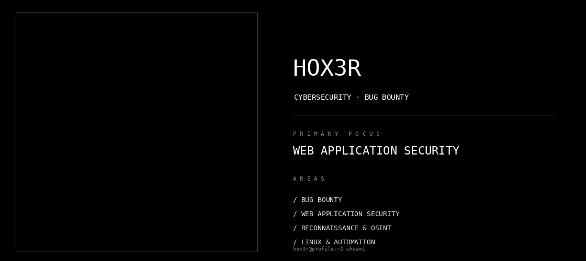

<p align="center">
  <picture>
    <source media="(max-width: 760px)" srcset="./assets/hero/hox3r-hero-mobile.gif">
    
  </picture>
</p>

<p align="center">
  <strong>BUG BOUNTY · WEB APPLICATION SECURITY · SECURITY RESEARCH</strong>
</p>

## <code>hox3r@profiles:~$ whoami</code>

```text
┌─[ IDENTITY ]───────────────────────────────────────────────┐
│                                                            │
│  Alias          : HOX3R , roz ,soul, Anonymous, heidar     │
│  Role           : Aspiring Red Team Operator               │
│  Focus          : Web Penetration Testing                  │
│  Approach       : Enumerate · Exploit · Validate · Report  │
│  Status         : Hunting Vulnerabilities                  │
│                                                            │
└────────────────────────────────────────────────────────────┘
```

## <code>hox3r@profiles:~$ cat mission.txt</code>

```text
[ MISSION ]

    [focus]
    bug_hunting      = true
    security_research = true
    automation       = true
    ai_agents        = true

    [objective]
    target           = critical_bugs
    ambition         = high_value_bounties
    goal             = financial_success

    [mindset]
    workflow         = understand -> analyze -> exploit
```


## <code>hox3r@profiles:~$ ./road-to-red-team.sh</code>

```text
[ 01 ] FOUNDATIONS
       Networking · Linux · Windows · Programming · Git

[ 02 ] RECONNAISSANCE & ATTACK-SURFACE MAPPING
       OSINT · DNS · Asset Discovery · Enumeration

[ 03 ] WEB & API APPLICATION SECURITY
       OWASP · Burp Suite · Authentication · API Testing

[ 04 ] NETWORK & INFRASTRUCTURE PENETRATION TESTING
       Network Services · SMB · SSH · Exploitation

[ 05 ] WINDOWS & ACTIVE DIRECTORY
       Windows Internals · Kerberos · LDAP · ADCS
       BloodHound · Identity Attack Paths

[ 06 ] EXPLOITATION & PRIVILEGE ESCALATION
       Linux · Windows · Credential Access
       Post-Exploitation · Lateral Movement

[ 07 ] CLOUD & MODERN INFRASTRUCTURE SECURITY
       AWS · Azure · Entra ID · Docker · Kubernetes

[ 08 ] RED TEAM TRADECRAFT
       MITRE ATT&CK · Threat Intelligence
       Adversary Emulation · EDR · Detection Engineering

[ 09 ] COMMAND & CONTROL OPERATIONS
       C2 Architecture · Infrastructure · OPSEC
       Payload Management · Operational Security

[ 10 ] RED TEAM OPERATIONS & REPORTING
       Rules of Engagement · Objective-Based Operations
       Evidence · Impact Analysis · Reporting
       Cleanup · Purple Team · Lessons Learned
```

## <code>hox3r@profiles:~$ cat my-skill.txt</code>

### `01 / WEB SECURITY`
<p align="left">
  
  
  
  
</p>

### `02 / RECON & ATTACK SURFACE`
<p align="left">
  
  
  
  
  
  
</p>

### `03 / DISCOVERY & EXPLOITATION`
<p align="left">
  
  
  
  
  
  
  
  
</p>

### `04 / PROGRAMMING`
<p align="left">
  
</p>

### `05 / SYSTEMS & INFRASTRUCTURE`
<p align="left">
  
</p>

### `06 / AUTOMATION & AI`

<p align="left">
  
  
  
  
  
</p>


## <code>hox3r@profile:~$ ./activity.sh</code>

<p align="center">
  <picture>
    <source media="(prefers-color-scheme: dark)" srcset="https://raw.githubusercontent.com/hox3r/hox3r/output/github-contribution-grid-snake-dark.svg">
    <source media="(prefers-color-scheme: light)" srcset="https://raw.githubusercontent.com/hox3r/hox3r/output/github-contribution-grid-snake.svg">
    
  </picture>
</p>


## `hox3r@profile:~$ ./connect.sh`

- **GitHub:** [github.com/hox3r](https://github.com/hox3r)
- **Email:** [hox3r@proton.me](mailto:hox3r@proton.me)
- **Instagram:** [coming soon](https://www.instagram.com/hox3r/)
- **X:** [coming soon](https://x.com/hox3r)
- **LinkedIn:** [coming soon](https://www.linkedin.com/in/hox3r/)
---

<p align="center"><code> Follow me and welcome to the hackers community. </code></p>
